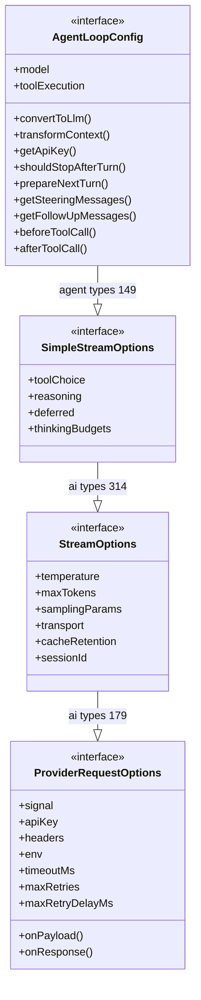

# AgentLoopConfig 的继承链路梳理

> 记录日期：2026-09-19
> 起点：`packages/agent/src/types.ts:149` 的 `export interface AgentLoopConfig extends SimpleStreamOptions {`
> 这条链**横跨两个包**（agent → ai），是理解「一个配置对象如何贯穿三层架构」的最好线索。

## 一、完整继承链（自顶向下）

```
AgentLoopConfig                          packages/agent/src/types.ts:149
  extends SimpleStreamOptions            packages/ai/src/types.ts:314
    extends StreamOptions                packages/ai/src/types.ts:179
      extends ProviderRequestOptions<Model<Api>>   packages/ai/src/types.ts:124（根）
```

继承方向恰好对应架构分层：**agent 行为层 → 推理中立层 → 采样层 → 传输/认证层**。每继承一层，加一批字段，从不删减——所以 `AgentLoopConfig` 的实例同时是全部四层的形状。

## 二、逐层拆解：每层新增了什么

### 第 1 层：`ProviderRequestOptions<TModel>`（根，ai/src/types.ts:124）

**管的是「HTTP 请求怎么发」**——所有 provider 共享的传输/认证/生命周期选项：

| 字段 | 作用 |
|---|---|
| `signal?: AbortSignal` | 取消令牌（≈ Go 的 context.Context） |
| `apiKey?` / `headers?` / `env?` | 认证注入（由 `applyAuth` 解析后填进来） |
| `onPayload?` / `onResponse?` | **发送前改写 payload / 响应后回调**——扩展系统的 HTTP 挂点 |
| `fetch?` | 自定义 fetch 实现（测试/代理用） |
| `timeoutMs?` / `maxRetries?` / `maxRetryDelayMs?` | 超时与重试控制 |

注意它是**泛型接口**：`<TModel = Model<Api>>` 带默认参数，图片生成那套用不同的模型类型复用它。

### 第 2 层：`StreamOptions extends ProviderRequestOptions<Model<Api>>`（ai/src/types.ts:179）

**管的是「LLM 怎么采样」**——把泛型钉死为 `Model<Api>`，新增：

`temperature` / `maxTokens` / `samplingParams`（任意采样参数直通自定义服务器）/ `transport`（sse/websocket）/ `cacheRetention`（提示词缓存时长）/ `sessionId` / `metadata`。

### 第 3 层：`SimpleStreamOptions extends StreamOptions`（ai/src/types.ts:314）

**管的是「provider 中立的推理控制」**，只加 4 个字段：

- `toolChoice?: "auto" | "none"`
- `reasoning?: ThinkingLevel`（6 档思考等级，各适配层翻译成厂商方言）
- `deferred?`（异步长任务）
- `thinkingBudgets?`（按档位的 token 预算）

对照：`streamSimple()` 吃的就是这个类型；`stream()` 吃的是 `ApiStreamOptions`（按协议映射到 `AnthropicOptions` 等原生选项）——那是**平行的另一条分支**，不在本链上。

### 第 4 层：`AgentLoopConfig extends SimpleStreamOptions`（agent/src/types.ts:149）

**管的是「agent 循环怎么跑」**——agent 包在 ai 包选项之上加的循环行为：

| 字段 | 作用 |
|---|---|
| `model` | 本轮用的模型（必填） |
| `convertToLlm` | AgentMessage[] → LLM Message[] 的桥（必填） |
| `transformContext` | 每次调用前修剪/注入上下文（compaction 挂点） |
| `getApiKey` | 每次调用动态取 key（短命 OAuth token） |
| `shouldStopAfterTurn` / `prepareNextTurn` | 回合级控制（自动压缩换模型的挂点） |
| `getSteeringMessages` / `getFollowUpMessages` | 插话与追问队列 |
| `toolExecution` / `beforeToolCall` / `afterToolCall` | 工具执行的三个控制点 |

## 三、为什么这样继承：一个对象贯穿三层

关键在 agent 循环里的这个调用（`packages/agent/src/agent-loop.ts:305`）：

```ts
const response = await streamFunction(config.model, llmContext, {
    ...config,              // ← 把 AgentLoopConfig 整个展开，当作流式选项传下去
    apiKey: resolvedApiKey, // 覆盖个别字段
    signal,
});
```

**正因为 `AgentLoopConfig` 继承了全部流式选项，`{...config}` 一个展开就能把循环配置原样传给 `StreamFn`**（`streamFunction` 的第三参就是 `SimpleStreamOptions`）。没有这条继承链，这里就得逐字段手工搬运。

这是 TS/JS 里很典型的「**配置对象分层继承 + 展开传递**」模式：每层只声明自己新增的部分，传参时整体下放、逐层消费。

## 四、涉及的 TS 语法点

1. **`interface A extends B`**：类型层面的继承（可多继承 `extends A, B`）。编译后完全擦除——它只是"形状的并集"，没有运行时的父类概念。对比 Java 的 `interface extends interface` 很像；对比 Go 更像 struct embedding 的类型效果（但无运行时提升方法）。
2. **与交叉类型的对比**：仓库里还有 `ProviderStreamOptions = StreamOptions & Record<string, unknown>`（ai/src/types.ts:225）——`&` 交叉类型是"类型代数运算"，`extends` 是"声明式继承"。效果相近，但 `extends` 有明确的报错语义（同名不兼容字段会直接报错，`&` 可能得到 never），可读性也更好。新代码声明接口时优先 `extends`。
3. **泛型默认参数的钉死**：根接口是 `<TModel = Model<Api>>`，第二层 `extends ProviderRequestOptions<Model<Api>>` 把泛型钉死——下游从此不用再写泛型参数。这是"泛型接口先留弹性、子类型收敛"的惯用法。

## 五、阅读锚点（点击跳转）

```
packages/agent/src/types.ts:149     AgentLoopConfig（本链顶层）
packages/ai/src/types.ts:314        SimpleStreamOptions
packages/ai/src/types.ts:179        StreamOptions
packages/ai/src/types.ts:124        ProviderRequestOptions（根）
packages/ai/src/types.ts:260        ApiStreamOptions（平行分支：原生选项映射）
packages/agent/src/agent-loop.ts:305  {...config} 展开传递的现场
```

读完后回到 `docs/04-package-agent.md` 第 4 节的 trace，把 config 在循环里的流动路径再走一遍。

## 六、UML 类图

> 本版已避开 `note for`、泛型 `~T~` 等较新的 Mermaid 语法，Typora / VS Code（装 "Markdown Preview Mermaid Support" 扩展）/ GitHub 网页均可渲染。



读图要点：

- 箭头 `--|>` 读作「继承」，箭头指向父类型；连线上的标注是定义位置（`agent types 149` 即 `packages/agent/src/types.ts:149`）
- 分层自顶向下 = **第4层 agent 行为 → 第3层中立推理 → 第2层采样 → 第1层传输认证**，与本文第二节的逐层拆解一一对应
- 字段**除 `model` 和 `convertToLlm()` 必填外全部可选**（对应类型里的 `?`）
- `ProviderRequestOptions` 实际是泛型根接口（`TModel = Model<Api>`，第 2 层继承时钉死），图里省略了泛型记号以兼容旧版渲染器
- 这条链存在的意义：`agent-loop.ts:305` 处 `{...config}` 一个展开就能把循环配置整体传给 `StreamFn`（见第三节）
